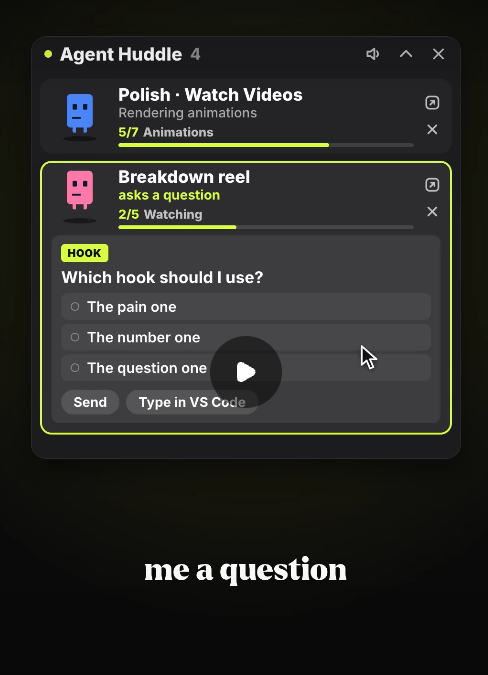

# Huddle — Agent Panel for Claude Code

A side pane mod for Claude Code that shows your Truckly project agents at work, inspired by [Agent Huddle](screenshot.png).



## Features

- **Agent cards** with rounded borders, colored by state (blue = working, yellow = waiting, green = done, gray = closed)
- **Contextual icons** per agent based on what they're doing (bug fix, test, API, map, deploy...)
- **Inline QCM questions** — when an agent needs your input, its card highlights yellow and shows the question with clickable options
- **Progress bars** showing queue depth
- **Expandable logs** — click an agent card to see recent activity and blockers
- **Session to-do list** — every prompt you type appears as a pending item, auto-cleared when Claude finishes the turn
- **Dual polling** — full refresh every 3 min, light refresh every 30s

## Install

```bash
claude plugin install huddle --marketplace julesSeluj/claude-mods-huddle
```

Or add the mod folder to `CLAUDE_CODE_PLUGIN_DIRS` in `~/.claude/settings.json`.

## Commands

- `/huddle` — open the pane
- `/huddle-refresh` — force a full data refresh
- `/huddle-answer <ticket> <key>` — answer a question from the CLI

## Data source

Reads from `etat-postes.mjs` in the Truckly worktree method repo. The answer script (`repondre-question.mjs`) is only called on explicit user click, never automatically.
